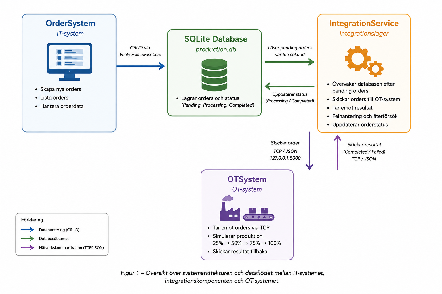
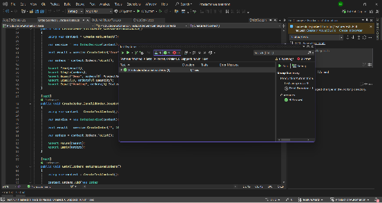
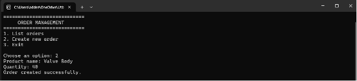
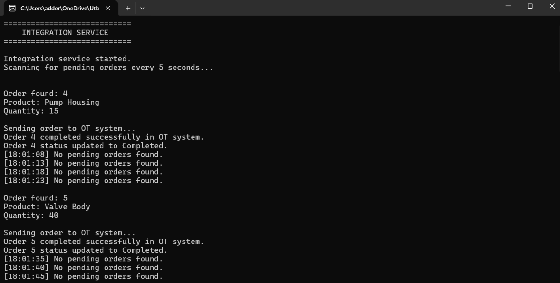
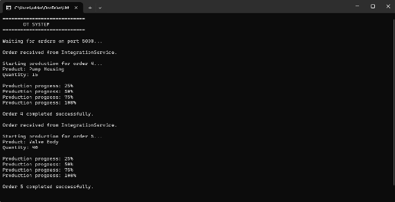
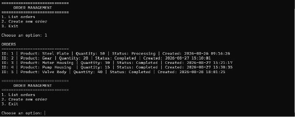
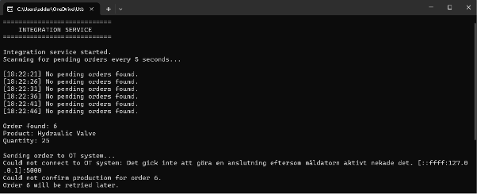
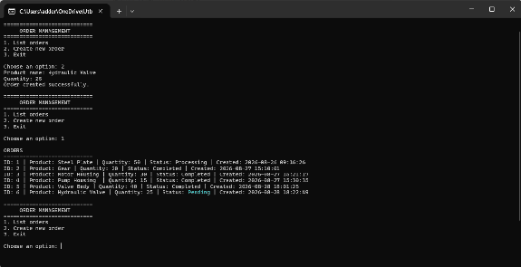

**Automatisering och säkerhetsintegration av ett produktionssystem**

**Inlämningsuppgift \#1 – Automatisering och integration**

**Namn:** Adryan Rajabi  
**Projekt:** ProductionAutomation  
**Tekniker:** C\#, .NET 9, Entity Framework Core, SQLite, TCP/IP, JSON, xUnit

**1\. Inledning**

**1.1 Problemområde**

Ett tillverkningsföretag är beroende av att information kan överföras på ett tillförlitligt och effektivt sätt mellan företagets IT-system och den operativa produktionsmiljön, OT. Om orderinformation behöver hanteras manuellt mellan dessa miljöer finns risk för fördröjningar, felaktig datainmatning och bristande spårbarhet. Manuella moment kan även leda till att produktionen blir beroende av att en operatör aktivt överför information mellan systemen.

En annan utmaning är tillförlitlighet och säkerhet. Om kommunikationen mellan systemen avbryts eller ett OT-system inte är tillgängligt behöver lösningen kunna hantera detta utan att information går förlorad eller att en order felaktigt markeras som genomförd. Det behövs därför validering, felhantering och ett tydligt orderflöde.

För att hantera dessa problem har jag utvecklat en simulerad IT/OT-miljö där orderhantering, integration och produktion är uppdelade i separata program. Syftet är att automatisera överföringen av produktionsorder från IT-sidan till OT-sidan och samtidigt hantera fel som kan uppstå under processen.

**1.2 Lösning och syfte**

Lösningen, ProductionAutomation, består av tre separata C\#-applikationer: OrderSystem, IntegrationService och OTSystem. Dessutom finns ett separat xUnit-projekt för automatiserad testning.

**OrderSystem** representerar IT-sidan och används för att skapa och lista produktionsorder. Orderinformationen lagras i en gemensam SQLite-databas med hjälp av Entity Framework Core.

**IntegrationService** fungerar som länken mellan IT- och OT-miljön. Tjänsten kontrollerar automatiskt databasen efter order med status Pending. Kontrollen sker med fem sekunders intervall. När en väntande order upptäcks ändras dess status till Processing och orderinformationen serialiseras till JSON och skickas via TCP till OTSystem.

**OTSystem** representerar produktionsmiljön. Systemet lyssnar efter inkommande anslutningar på 127.0.0.1:5000. När en order tas emot simuleras produktionen i steg om 25, 50, 75 och 100 procent. När produktionen är färdig skickas statusen Completed tillbaka till IntegrationService, som därefter uppdaterar ordern i databasen.

Lösningen automatiserar därmed hela processen från att en användare skapar en order tills den har behandlats av det simulerade OT-systemet. Målet är att minska behovet av manuell överföring mellan systemen samt förbättra tillförlitlighet, felhantering och insyn i orderstatus.

**2\. Design och Arkitektur**

**2.1 Systemarkitektur**

Lösningen är uppdelad i tre fristående applikationer för att simulera separationen mellan IT-system, integrationslager och OT-system. Separationen gör det möjligt att tydligt definiera varje komponents ansvar och efterliknar en förenklad industriell arkitektur.

OrderSystem ansvarar för användarinteraktionen och orderhanteringen. IntegrationService ansvarar för automatiseringen och kommunikationen mellan systemen, medan OTSystem ansvarar för den simulerade produktionsprocessen.

OrderSystem och IntegrationService använder samma SQLite-databas. IntegrationService läser väntande order från databasen och kommunicerar därefter med OTSystem via en TCP-anslutning. Orderinformationen serialiseras till JSON innan den skickas. Efter avslutad produktion skickar OTSystem tillbaka resultatet till IntegrationService, som uppdaterar orderstatusen i databasen.

**Figur 1 – Översikt över systemarkitekturen och dataflödet mellan IT-systemet, integrationskomponenten och OT-systemet.** 

**2.2 Teknikval och integrationsmetod**

Lösningen är utvecklad i C\# med .NET 9, eftersom C\# är det huvudsakliga programmeringsspråket som används i kursen och erbjuder bra stöd för objektorienterad programmering, nätverkskommunikation, databashantering och testning.

SQLite valdes som databas eftersom lösningen är en lokal simulering och inte kräver en separat databasserver. Databasen hanteras genom Entity Framework Core, vilket förenklar arbetet med att skapa, läsa och uppdatera orderdata från C\#.

Kommunikationen mellan IntegrationService och OTSystem implementerades med TCP. OTSystem fungerar som TCP-server och lyssnar lokalt på port 5000, medan IntegrationService fungerar som TCP-klient. TCP valdes eftersom protokollet erbjuder anslutningsorienterad och tillförlitlig överföring och samtidigt tydligt demonstrerar kommunikation mellan två separata applikationer.

Orderdata serialiseras till JSON innan den skickas över TCP. JSON valdes eftersom formatet är enkelt att läsa, felsöka och serialisera mellan objekt i de två systemen.

För automatiserad testning används xUnit. Testprojektet innehåller både enhetstester av ordervalideringen och integrationstester där OrderService testas tillsammans med en SQLite-databas i minnet. På så sätt kan databasfunktionaliteten testas utan att den riktiga production.db påverkas.

**3\. Implementering**

Implementeringen är uppdelad i tre separata C\#-applikationer som tillsammans representerar IT-systemet, integrationslagret och OT-systemet. Lösningen har utvecklats stegvis där varje komponent först implementerades och testades separat innan kommunikationen mellan systemen kopplades samman. Utöver dessa tre applikationer skapades även ett separat xUnit-projekt för automatiserade tester.

**3.1 OrderSystem**

OrderSystem är lösningens simulerade IT-system och är implementerat som en Console Application. Programmet ger användaren möjlighet att lista befintliga order, skapa nya order och avsluta programmet.

En order representeras av modellen Order och innehåller egenskaperna Id, ProductName, Quantity, Status och CreatedAt. När en ny order skapas får den automatiskt statusen Pending, vilket signalerar till IntegrationService att ordern väntar på behandling.

För datalagring används Entity Framework Core tillsammans med SQLite. Klassen AppDbContext ansvarar för kommunikationen med databasen production.db, medan OrderService innehåller logiken för att skapa och hämta order. Genom att separera databasåtkomst, modeller, tjänster och användargränssnitt blir programmet mer strukturerat och enklare att underhålla.

Vid hämtning av order används AsNoTracking(). Detta blev viktigt eftersom OrderSystem och IntegrationService arbetar mot samma databas. Utan detta kunde Entity Framework behålla en tidigare version av en order i minnet trots att IntegrationService hade ändrat dess status. Med AsNoTracking() hämtas aktuell information från databasen när orderlistan visas.

**Ordervalidering**

Innan en order sparas valideras den genom OrderValidator. Produktnamnet får inte vara tomt eller endast bestå av blanksteg, och kvantiteten måste vara större än noll. I implementationen finns även kontroll som förhindrar att ett produktnamn endast består av siffror. Om valideringen misslyckas sparas ordern inte i databasen och användaren får ett felmeddelande.

Valideringen minskar risken för att felaktiga eller ofullständiga order når integrations- och produktionssystemet.

**3.2 IntegrationService**

IntegrationService fungerar som länken mellan IT- och OT-systemet och ansvarar för huvuddelen av automatiseringen. Tjänsten kör kontinuerligt och söker efter order med status Pending i SQLite-databasen.

Databasen kontrolleras med fem sekunders intervall. När en väntande order hittas ändras dess status till Processing. Orderinformationen serialiseras därefter till JSON och skickas till OTSystem genom en TCP-anslutning till 127.0.0.1 på port 5000\.

Kommunikationen hanteras av OTClient, medan OrderIntegrationService ansvarar för att läsa order och uppdatera deras status i databasen. Denna separation gör att nätverkskommunikation och databaslogik inte behöver hanteras direkt i programmets huvudflöde.

Efter att ordern skickats väntar IntegrationService på resultat från OTSystem. Om produktionen slutförs returneras Completed och orderns status uppdateras i databasen. Om produktionen misslyckas kan ordern istället markeras som Failed. På detta sätt fungerar IntegrationService både som integrationslager och som orkestrerare av orderflödet.

**Automatiseringen**

Automatiseringen innebär att användaren endast behöver skapa ordern. Därefter krävs ingen manuell överföring till OT-systemet. IntegrationService upptäcker ordern automatiskt och initierar produktionsprocessen.

**3.3 OTSystem**  
OTSystem simulerar den operativa produktionsmiljön och är också implementerat som en Console Application. Systemet fungerar som TCP-server och väntar på inkommande order från IntegrationService på port 5000\.

När data tas emot deserialiseras JSON-informationen till ett ProductionOrder-objekt. Därefter skickas ordern till ProductionService, som simulerar en produktionsprocess.

Produktionen visualiseras genom fyra steg: 25 %, 50 %, 75 % och 100 %. Mellan varje steg används en kort väntetid för att simulera att produktionen tar tid. När processen når 100 % ändras orderns status till Completed.

Resultatet skickas därefter tillbaka till IntegrationService, vilket gör att IT-sidan kan få information om att produktionen har slutförts och uppdatera den gemensamma orderstatusen.

**3.4 Automatiserat orderflöde**

Det fullständiga automatiserade orderflödet består av följande steg:

1. Användaren skapar en order i OrderSystem.  
2. Ordern lagras i SQLite-databasen med status Pending.  
3. IntegrationService upptäcker automatiskt ordern.  
4. Statusen ändras till Processing.  
5. Ordern serialiseras till JSON och skickas via TCP till OTSystem.  
6. OTSystem simulerar produktionen.  
7. OTSystem skickar resultatet tillbaka till IntegrationService.  
8. IntegrationService uppdaterar ordern till Completed i databasen.  
9. OrderSystem kan därefter visa den uppdaterade statusen.

**3.5 Felhantering och robusthet**

Felhantering implementerades på flera nivåer för att förhindra att ett enskilt fel orsakar att hela integrationsprocessen avslutas.

Databasoperationer och nätverkskommunikation omges av felhantering för att fånga förväntade undantag. I OTClient hanteras bland annat SocketException, vilket kan uppstå om OTSystem inte är tillgängligt när IntegrationService försöker ansluta.

Om kommunikationen med OTSystem misslyckas markeras ordern inte som slutförd. Istället återställs statusen till Pending, vilket gör att IntegrationService kan försöka behandla ordern igen senare. Efter ett misslyckat försök används även en extra väntetid innan nästa försök för att undvika omedelbara upprepade anslutningsförsök.

Detta beteende testades genom att medvetet stänga av OTSystem och därefter skapa en ny order. IntegrationService fångade anslutningsfelet utan att krascha och ordern förblev Pending. När OTSystem senare blir tillgängligt kan ordern därför behandlas vid ett nytt försök.

**4\. Säkerhetsanalys och Åtgärder**

Integration mellan IT- och OT-system innebär flera säkerhetsrisker eftersom data och kommandon överförs mellan två miljöer med olika funktion och säkerhetskrav. Ett fel eller en attack på IT-sidan kan i värsta fall påverka den fysiska produktionsprocessen på OT-sidan. Därför analyserades lösningen utifrån bland annat felaktig indata, datamanipulation, obehörig åtkomst, nätverkskommunikation och systemtillgänglighet.

Den utvecklade lösningen är en lokal simulering och innehåller därför inte samtliga säkerhetsmekanismer som skulle krävas i en verklig produktionsmiljö. Ett antal åtgärder har implementerats, medan ytterligare säkerhetsåtgärder har identifierats som lämpliga för vidareutveckling.

**4.1 Identifierade risker och sårbarheter**

| Risk | Möjlig konsekvens |
| ----- | ----- |
| Felaktig orderdata | Ogiltiga produktionsorder kan skickas till OT-systemet. |
| OTSystem är otillgängligt | Produktionsorder kan inte behandlas och integrationen kan avbrytas. |
| Manipulation av databasen | Orderinformation, kvantitet eller status kan ändras utan tillåtelse. |
| Obehörig TCP-kommunikation | En obehörig klient skulle potentiellt kunna skicka data till OTSystem. |
| Okrypterad kommunikation | JSON-data över TCP kan potentiellt avlyssnas eller manipuleras om kommunikationen sker över ett riktigt nätverk. |
| Manipulerade JSON-meddelanden | OTSystem kan ta emot data som inte kommer från den legitima IntegrationService. |
| Upprepade anslutningsförsök | Ett otillgängligt system kan orsaka många återkommande anslutningsförsök. |
| Bristande autentisering | Systemet kan inte verifiera identiteten på den komponent som ansluter. |

En särskilt viktig risk i en IT/OT-miljö är att en komprometterad IT-komponent kan användas för att påverka OT-miljön. I denna lösning skickas produktionsorder från IntegrationService direkt till OTSystem. Om en angripare exempelvis kunde manipulera databasen eller skicka egna TCP-meddelanden skulle felaktiga produktionsorder potentiellt kunna initieras.

I en verklig industriell miljö kan konsekvenserna vara större än i ett vanligt IT-system, eftersom felaktiga kommandon kan påverka maskiner, produktionskvalitet, tillgänglighet och i vissa fall fysisk säkerhet.

**4.2 Implementerade säkerhets- och robusthetsåtgärder**

**Validering av orderdata**

OrderSystem validerar orderinformation innan den lagras i databasen. Produktnamnet måste innehålla giltig information och kvantiteten måste vara större än noll. Felaktiga order stoppas därför redan på IT-sidan innan de kan skickas vidare mot produktionssystemet.

Detta följer principen att data bör valideras så tidigt som möjligt i flödet och minskar risken för att felaktig indata påverkar senare komponenter.

**Felhantering vid nätverkskommunikation**

Nätverkskommunikationen mellan IntegrationService och OTSystem innehåller exception handling. SocketException fångas exempelvis om OTSystem inte går att nå. IntegrationService avslutas därmed inte på grund av ett förväntat nätverksfel utan kan fortsätta köras.

Detta förbättrar systemets tillgänglighet och robusthet eftersom ett tillfälligt fel i OTSystem inte automatiskt leder till att integrationskomponenten slutar fungera.  
**Säker orderstatus**

Orderstatus används för att kontrollera var i processen en order befinner sig. En ny order börjar som Pending, ändras till Processing när behandlingen påbörjas och markeras först som Completed när OTSystem har bekräftat att produktionen slutförts.

Om kommunikationen misslyckas återställs ordern till Pending istället för att felaktigt markeras som genomförd. Detta minskar risken för att IT-systemet visar att en produktionsorder har genomförts trots att OT-systemet aldrig behandlade den.

**Kontrollerade återförsök**

Vid ett misslyckat kommunikationsförsök väntar IntegrationService innan ett nytt försök görs. Den extra väntetiden minskar antalet omedelbara återanslutningar när OTSystem är otillgängligt.

Lösningen är en enkel retry-mekanism. I ett större system skulle den kunna vidareutvecklas med exempelvis ett maximalt antal försök och exponentiell backoff.

**4.3 Säkerhetsåtgärder som inte är implementerade**

Eftersom projektet är en lokal simulering har vissa säkerhetsfunktioner inte implementerats. Dessa skulle däremot vara nödvändiga eller starkt rekommenderade om lösningen användes i en verklig IT/OT-miljö.

| Åtgärd | Hur den skulle förbättra lösningen |
| ----- | ----- |
| Autentisering mellan systemen | OTSystem skulle kunna verifiera att inkommande order verkligen kommer från en betrodd IntegrationService. |
| TLS-kryptering | Skyddar orderinformationen mot avlyssning och manipulation under överföring. |
| Auktorisering | Begränsar vilka användare och system som får skapa eller behandla produktionsorder. |
| Säker loggning | Gör det möjligt att spåra anslutningar, fel, statusändringar och misstänkta händelser. |
| Nätverkssegmentering | Separerar IT- och OT-miljöerna och begränsar direkt kommunikation mellan dem. |
| Brandväggsregler | Endast nödvändig kommunikation mellan integrationskomponenten och OTSystem tillåts. |
| Integritetskontroll av meddelanden | Kan upptäcka om orderdata manipulerats under överföring. |
| Begränsade databasbehörigheter | Minskar konsekvenserna om en applikation eller användare komprometteras. |

TCP-kommunikationen i den nuvarande lösningen sker lokalt via 127.0.0.1:5000 och är inte krypterad eller autentiserad. Detta är acceptabelt för den aktuella simuleringen men skulle inte vara tillräckligt i en verklig produktionsmiljö.

En produktionsanpassad version skulle exempelvis kunna använda TLS för krypterad kommunikation och certifikat eller annan maskin-till-maskin-autentisering för att verifiera IntegrationService innan OTSystem accepterar produktionsorder.

**4.4 IT/OT-separering och defense in depth**

En viktig princip vid industriell cybersäkerhet är att ett OT-system inte bör exponeras direkt mot användare eller andra IT-system utan kontroll. I den utvecklade arkitekturen kommunicerar OrderSystem därför inte direkt med OTSystem. Kommunikation sker istället genom IntegrationService.

Denna uppdelning ger en tydligare gräns mellan systemen och skapar en plats där validering, loggning, autentisering och andra säkerhetskontroller skulle kunna implementeras. I en verklig miljö skulle integrationskomponenten kunna placeras i ett separat nätverkssegment eller en industriell DMZ.

Detta kan kombineras med principen defense in depth, där säkerheten inte bygger på en enda kontroll. Validering, nätverkssegmentering, autentisering, kryptering, loggning och begränsade behörigheter kan tillsammans göra det svårare för ett intrång i IT-miljön att spridas vidare till OT-miljön.

**4.5 Proaktiv säkerhet**

Lösningens validering och felhantering bidrar till ett mer proaktivt arbetssätt eftersom vissa problem hanteras innan de orsakar större fel i produktionsflödet. Felaktig orderdata stoppas innan den når OTSystem och nätverksfel leder inte till att en order felaktigt markeras som slutförd.

Samtidigt visar säkerhetsanalysen att robusthet och cybersäkerhet inte är samma sak. Att systemet kan återhämta sig från ett anslutningsfel innebär exempelvis inte att kommunikationen är skyddad mot en angripare. En verklig implementation behöver därför kombinera den befintliga felhanteringen med autentisering, kryptering, loggning, behörighetskontroll och nätverkssegmentering.

**5\. Testning och Resultat**

**5.1 Teststrategi**

Testningen genomfördes på flera nivåer för att kontrollera både enskilda komponenter och det fullständiga integrationsflödet. Teststrategin bestod av enhetstester, integrationstester, manuella end-to-end-tester samt negativa tester där fel medvetet introducerades.

Automatiserade tester implementerades med xUnit i det separata projektet ProductionAutomation.Tests. Utöver dessa tester verifierades hela flödet manuellt genom att köra OrderSystem, IntegrationService och OTSystem samtidigt.

Positiva tester användes för att verifiera att korrekta order kunde skapas, överföras och slutföras. Negativa tester användes bland annat för felaktig orderdata och för scenariot där OTSystem inte var tillgängligt.

**5.2 Enhetstester**

Enhetstester skapades för OrderValidator för att kontrollera att orderdata valideras korrekt innan en order sparas. Totalt skapades sex tester som omfattade både giltiga och ogiltiga indata.

Testfallen kontrollerade en giltig order, tomt produktnamn, produktnamn bestående av blanksteg, produktnamn bestående endast av siffror, kvantiteten noll samt negativ kvantitet. En giltig order accepterades medan de ogiltiga fallen avvisades enligt de definierade valideringsreglerna.

| Testfall | Förväntat resultat |
| ----- | ----- |
| Giltigt produktnamn och kvantitet | Godkänd |
| Tomt produktnamn | Avvisad |
| Endast blanksteg | Avvisad |
| Endast siffror som produktnamn | Avvisad |
| Kvantitet \= 0 | Avvisad |
| Negativ kvantitet | Avvisad |

**5.3 Integrationstester**

Utöver enhetstesterna skapades tre integrationstester för OrderService och databashanteringen. Syftet var att verifiera att applikationslogiken fungerar tillsammans med Entity Framework Core och SQLite.

Testerna använder en separat SQLite-databas i minnet (in-memory). På så sätt kan verkliga databasoperationer utföras utan att påverka applikationens ordinarie production.db.  
Integrationstesterna verifierar att en giltig order kan sparas i databasen, att en ogiltig order inte sparas samt att sparade order kan hämtas genom GetAllOrders().

Samtliga sex enhetstester och tre integrationstester passerade, vilket gav totalt 9 godkända tester och 0 misslyckade tester.

**Figur 2 – Resultat från automatiserade tester i xUnit. Samtliga nio enhets- och integrationstester passerade utan fel.**

**5.4 End-to-end-test av det automatiserade orderflödet**

För att verifiera hela integrationskedjan genomfördes ett end-to-end-test med de tre applikationerna igång samtidigt. OTSystem startades först och väntade på inkommande order. Därefter startades IntegrationService, som började övervaka databasen efter order med status Pending.

I OrderSystem skapades därefter en ny produktionsorder för produkten Valve Body med kvantiteten 40\.

**Figur 3 – En ny produktionsorder skapas i OrderSystem som startpunkt för end-to-end-testet.**

Efter att ordern skapats upptäckte IntegrationService automatiskt den nya ordern vid nästa databaskontroll. Ordern skickades därefter vidare till OTSystem utan att användaren behövde överföra informationen manuellt.

  
**Figur 4 – IntegrationService upptäcker automatiskt ordern, skickar den till OTSystem och uppdaterar statusen efter slutförd produktion.**

OTSystem tog emot ordern via TCP och simulerade produktionsprocessen från 25 till 100 procent. När simuleringen slutförts skickades resultatet tillbaka till IntegrationService.

**Figur 5 – OTSystem behandlar produktionsorder. Order 5 (Valve Body) genomförs från 25 till 100 procent och markeras därefter som slutförd. Order 4 (Pump Housing) var tidigare väntande testdata och behandlades automatiskt när tjänsterna startades.**

Slutligen kontrollerades orderlistan i OrderSystem. Valve Body hade då status Completed, vilket bekräftade att resultatet från OTSystem hade återförts genom IntegrationService och sparats i databasen.

  
**Figur 6 – OrderSystem visar att order 5 (Valve Body) har uppdaterats till Completed efter den automatiserade produktionsprocessen.**

**5.5 Negativt test – OTSystem otillgängligt**

Ett negativt end-to-end-test genomfördes för att verifiera systemets beteende vid nätverks- eller systemfel. OTSystem stängdes av medan OrderSystem och IntegrationService fortsatte att köras.

En ny order för Hydraulic Valve med kvantiteten 25 skapades i OrderSystem. IntegrationService upptäckte ordern och försökte ansluta till OTSystem på port 5000\. Eftersom OTSystem var avstängt nekades anslutningen.

**Figur 7 – Negativt test där IntegrationService hanterar ett anslutningsfel när OTSystem är otillgängligt. Felet fångas och tjänsten fortsätter att köras.**

Istället för att krascha eller felaktigt markera ordern som slutförd hanterade IntegrationService felet och återställde ordern till Pending. Detta innebär att ordern kan behandlas vid ett senare tillfälle när OTSystem åter är tillgängligt.

**Figur 8 – Efter det misslyckade anslutningsförsöket ligger order 6 (Hydraulic Valve) kvar som Pending, vilket möjliggör ett senare återförsök.**

**5.6 Testresultat**

| Test | Typ | Resultat |
| ----- | ----- | ----- |
| OrderValidator – giltig order  | Enhetstest | Godkänd |
| OrderValidator – ogiltiga indata  | Enhetstest | Godkänd |
| Skapa giltig order i SQLite  | Integrationstest | Godkänd |
| Förhindra ogiltig order i SQLite | Integrationstest | Godkänd |
| Hämta sparade order | Integrationstest | Godkänd |
| OrderSystem → IntegrationService → OTSystem  | End-to-end | Godkänd |
| Produktionsresultat → Completed  | End-to-end | Godkänd |
| OTSystem otillgängligt  | Negativt test | Godkänd |
| Order återgår till Pending efter kommunikationsfel  | Negativt test | Godkänd |

Testresultaten visar att lösningen uppfyller det definierade automatiseringsflödet. En order kan skapas på IT-sidan, upptäckas automatiskt av integrationskomponenten, skickas till OT-systemet och slutligen uppdateras till Completed utan manuell överföring mellan systemen.

De negativa testerna visar samtidigt att lösningen kan hantera ett förväntat kommunikationsfel utan att integrationsprogrammet kraschar eller att orderdata får en felaktig slutstatus. De nio automatiserade testerna kompletterar de manuella systemtesterna genom att verifiera validerings- och databasfunktionaliteten på ett reproducerbart sätt.

**Notering:** Order 1 (Steel Plate) är tidigare testdata från en tidig version av implementationen, innan återkopplingen av slutstatus från OTSystem hade implementerats. Den har därför behållit status Processing och ingår inte i de slutliga testfallen.

**6\. Slutsats och Reflektion**

**6.1 Sammanfattning**

Syftet med projektet var att utveckla en automatiserad lösning som integrerar ett simulerat IT-system med ett simulerat OT-system. Resultatet blev ProductionAutomation, som består av OrderSystem, IntegrationService och OTSystem samt ett separat projekt för automatiserade tester.

OrderSystem gör det möjligt att skapa och lista produktionsorder, medan IntegrationService automatiskt övervakar databasen och skickar väntande order vidare till OTSystem. OTSystem simulerar därefter produktionen och skickar resultatet tillbaka till IntegrationService, som uppdaterar orderns status i databasen.

Det slutliga flödet innebär att en användare endast behöver skapa en order. Överföringen till produktionssystemet, produktionsstarten och återrapporteringen av resultatet sker därefter automatiskt.

Lösningen demonstrerar därmed hur automatisering och IT/OT-integration kan minska behovet av manuella arbetsmoment. I en verklig tillverkningsmiljö skulle detta kunna bidra till kortare ledtider, färre manuella fel och bättre insyn i produktionsstatus. Automatisering kan även innebära kostnadsbesparingar genom att repetitiva arbetsmoment minskar och problem kan upptäckas och hanteras snabbare.

**6.2 Utmaningar och lärdomar**

En av de största lärdomarna från projektet var att integration mellan flera program innebär andra utmaningar än att utveckla ett enskilt program. Varje komponent kunde fungera korrekt separat samtidigt som problem ändå kunde uppstå när komponenterna började kommunicera med varandra.

Ett exempel var hanteringen av order-ID mellan IntegrationService och OTSystem. Under en tid användes olika egenskapsnamn för samma information, vilket resulterade i att OTSystem tog emot en order med ID 0\. Problemet löstes genom att använda samma egenskap, Id, genom hela dataflödet. Detta visade hur viktigt det är att systemen använder ett gemensamt och konsekvent dataformat.

En annan utmaning var databasens placering. När varje program använde en relativ sökväg kunde separata production.db-filer skapas i respektive programs output-katalog. Lösningen blev att använda en gemensam databas i solutionens Database-mapp, så att OrderSystem och IntegrationService arbetar mot samma information.

Ett ytterligare problem uppstod när en order hade uppdaterats av IntegrationService men OrderSystem fortfarande visade en äldre status. Detta var relaterat till Entity Framework Cores tracking av entiteter. Genom att använda AsNoTracking() vid hämtning av order kunde aktuell information läsas från databasen. Detta gav en bättre förståelse för hur databasens faktiska innehåll och objekt som Entity Framework håller i minnet inte alltid behöver vara samma sak.

Jag fick även en tydligare förståelse för betydelsen av felhantering i automatiserade system. Ett system kan fungera korrekt när alla komponenter är tillgängliga, men en robust lösning måste även definiera vad som händer när en komponent inte svarar. Testet där OTSystem stängdes av visade varför ordern inte bör markeras som slutförd förrän en faktisk bekräftelse har mottagits.

Projektet gav därför praktisk erfarenhet av hur databashantering, nätverkskommunikation, serialisering, automatisering och felhantering behöver fungera tillsammans för att skapa ett komplett integrationsflöde.

**6.3 Vidareutveckling**

Den nuvarande lösningen är avsiktligt relativt enkel och flera delar skulle kunna vidareutvecklas för att bättre efterlikna en verklig industriell miljö.

En viktig förbättring skulle vara att ersätta eller komplettera den enkla TCP-kommunikationen med ett mer industriellt kommunikationsprotokoll, exempelvis OPC UA eller Modbus TCP. Detta skulle göra simuleringen mer representativ för kommunikation som förekommer i OT-miljöer.

Säkerheten skulle också behöva förstärkas. Den nuvarande TCP-kommunikationen är inte krypterad eller autentiserad. En vidareutvecklad lösning skulle därför kunna använda krypterad kommunikation, maskin-till-maskin-autentisering och auktorisering för att kontrollera vilka system som får initiera produktionsorder.

Retry-mekanismen skulle kunna förbättras genom exponentiell backoff och ett maximalt antal försök. Efter upprepade misslyckanden skulle ordern exempelvis kunna få status Failed och ett larm genereras istället för att systemet fortsätter försöka obegränsat.

Ytterligare förbättringar skulle kunna vara strukturerad loggning, central övervakning och metrics genom exempelvis OpenTelemetry och Grafana. Detta skulle ge bättre insyn i orderflöden, fel, svarstider och tillgänglighet.

I en större miljö skulle även den lokala SQLite-databasen kunna ersättas av en central databastjänst och integrationskomponenten skulle kunna placeras i ett separat nätverkssegment mellan IT- och OT-miljöerna.

**6.4 Proaktivt förebyggande av sårbarheter och incidenthantering**

Lösningen innehåller flera mekanismer som bidrar till att problem hanteras innan de påverkar hela orderflödet. Validering förhindrar att vissa typer av felaktig data lagras och skickas vidare till OTSystem. Felhantering vid nätverkskommunikation förhindrar samtidigt att ett tillfälligt kommunikationsfel avslutar IntegrationService.

Statushanteringen är särskilt viktig ur ett tillförlitlighetsperspektiv. En order markeras inte som Completed enbart för att den har skickats till OTSystem, utan först efter att produktionsresultatet har bekräftats. Om kommunikationen misslyckas återgår ordern till Pending, vilket gör det möjligt att återuppta processen när OTSystem blir tillgängligt igen.

Samtidigt är det viktigt att skilja mellan att hantera tekniska fel och att förebygga säkerhetsincidenter. Den nuvarande lösningen kan exempelvis hantera att OTSystem är otillgängligt, men den kan inte avgöra om ett inkommande TCP-meddelande kommer från en legitim eller obehörig avsändare. Autentisering, kryptering, loggning och nätverkssegmentering skulle därför behövas för att lösningen även ska kunna motstå mer avancerade säkerhetshot.

I en verklig miljö skulle loggning och övervakning dessutom kunna användas för att upptäcka avvikande beteenden, exempelvis ovanligt många order, upprepade anslutningsfel eller oväntade statusändringar. Detta skulle förbättra möjligheten att upptäcka och hantera incidenter innan de får större påverkan på produktionen.

**6.5 Slutlig reflektion**

Projektet visar att automatisering inte enbart handlar om att få två system att kommunicera. För att en integration ska vara tillförlitlig behöver även datavalidering, statuskontroll, felhantering, testning och säkerhet beaktas.

Arbetet med ProductionAutomation gav en tydligare förståelse för hela kedjan från en order i ett IT-system till en åtgärd i ett OT-system och tillbaka igen. Framför allt blev det tydligt att fel och avbrott behöver betraktas som en normal del av ett distribuerat system och därför hanteras redan i designen, istället för först när ett problem uppstår.

Den färdiga lösningen uppfyller projektets grundläggande krav på automatiserad IT/OT-integration och har kompletterats med felhantering och automatiserade tester. Samtidigt finns tydliga möjligheter till vidareutveckling inom framför allt cybersäkerhet, övervakning och mer realistisk industriell kommunikation.
